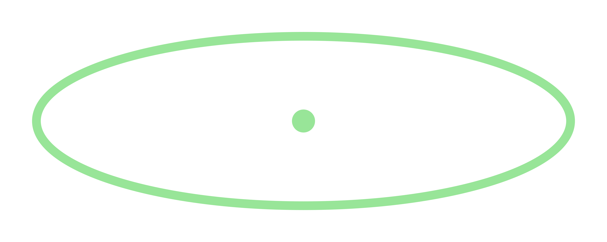

# Bureau Obscura Audio Fabricator

> **Non-commercial art project.** Bureau Obscura Audio Fabricator is an
> experimental local audio tool, not a commercial product or hosted service.
> YuE2 model weights retain their CC BY-NC 4.0 terms and the authors'
> additional individual-creator permission. See
> [MODEL_TERMS.md](packaging/windows/MODEL_TERMS.md) before downloading,
> using, or redistributing a model bundle.

Bureau Obscura Audio Fabricator is a Windows desktop workspace with two local
generation modes:

- **Music** opens the Bureau Obscura edition of YuE Studio, powered by
  YuE2-3B and YuE2-Vae.
- **Sound** opens the branded Stable Audio 3 Small SFX workspace for effects,
  atmospheres, and environmental recordings.

The launcher starts both loopback-only engines, waits for them to become
healthy, opens a dedicated Microsoft Edge app window, and shuts both engines
down when that window closes. Music always uses 127.0.0.1:55290 and Sound
uses 127.0.0.1:7860, so a restart does not strand the interface on a dead
random port.

## Download

Use the newest package on the
[Releases page](https://github.com/BureauObscura/audio-fabricator/releases).
The offline Windows release is split into numbered 7-Zip volumes because the
models and portable runtimes are larger than GitHub's per-asset limit.

1. Download the Bootstrap ZIP, SHA256SUMS.txt, and every numbered .7z part.
2. Put all files in one folder and extract the Bootstrap ZIP.
3. Run Extract-Bundle.ps1; it verifies every archive part before extraction.
4. Open Bureau Obscura Audio Fabricator.exe in the extracted folder.

The Git repository intentionally excludes model weights, generated takes,
Python environments, browser profiles, and credentials. Those belong in
release assets or on the local machine, not in Git history.

## Local data

YuE compositions and takes are stored outside the application folder:

~~~text
%LOCALAPPDATA%\YuE Studio
~~~

The application does not add personal library data to release packages.
Closing the desktop app stops both model services; it does not delete takes.

## Build the Windows bundle

The reproducible Windows tooling is under
[packaging/windows/](packaging/windows/). A build needs:

- Python 3.12 and Node.js 22;
- this source tree with the pinned YuE2 model files in models/;
- the Stable Audio 3 source revision recorded in
  [model-revisions.json](packaging/windows/model-revisions.json);
- the pinned Stable Audio TFLite model files;
- Microsoft Edge; and
- 7-Zip when creating split release assets.

Example:

~~~powershell
.\packaging\windows\build-offline-bundle.ps1 -StableRoot C:\path\to\stable-audio-3 -OutputRoot C:\path\to\AudioFabricatorRelease -Version 1.0.1
.\packaging\windows\make-release-assets.ps1 -ReleaseRoot C:\path\to\AudioFabricatorRelease\v1.0.1 -Version 1.0.1
~~~

The scripts do not silently download or relicense model weights. Exact model
revisions, notices, and major-file hashes are recorded in the built package.

## Source layout

- studio/ — local library, composition editor, music API, and web interface.
- src/yue2/ — YuE2 generation runtime and artifact protocol.
- packaging/windows/ — branded launcher, offline bundler, extractor, notices,
  and the Stable Audio integration patch.
- skills/ — local YuE2 music workflow support.
- docs/YUE2-UPSTREAM-README.md — preserved YuE2 project documentation.
- SOURCE_PROVENANCE.md — exact source snapshot and upstream revisions.

## Tests

The Studio suite does not download models or call paid providers:

~~~powershell
python -m unittest discover -s studio/tests -p "test_*.py"
~~~

The repaired Windows release was also exercised through a real
generate-and-cancel workflow, two consecutive desktop launches, both health
endpoints, and clean model shutdown.

## Licensing and attribution

Source code and model files do not share one license.

- YuE2 source: Apache License 2.0.
- YuE2 weights: CC BY-NC 4.0 plus the bundled individual-creator permission.
- Stable Audio 3 runtime source: MIT.
- Stable Audio model files: Stability AI Community License and current
  Acceptable Use Policy. **Powered by Stability AI.**
- T5Gemma: Gemma Terms of Use and prohibited-use policy.

The Bureau Obscura name and interface do not imply endorsement by the YuE2
authors, Stability AI, Google, or any other upstream contributor.

See [MODEL_TERMS.md](packaging/windows/MODEL_TERMS.md),
[NOTICE.txt](packaging/windows/NOTICE.txt), and
[SOURCE_PROVENANCE.md](SOURCE_PROVENANCE.md) for details.
